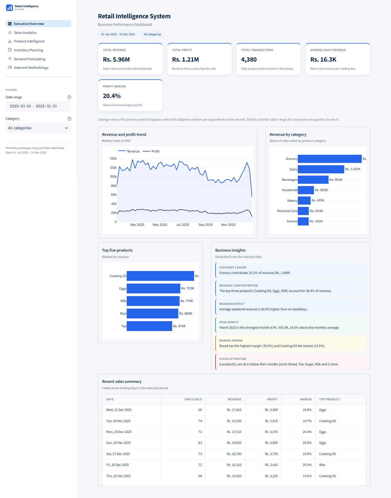
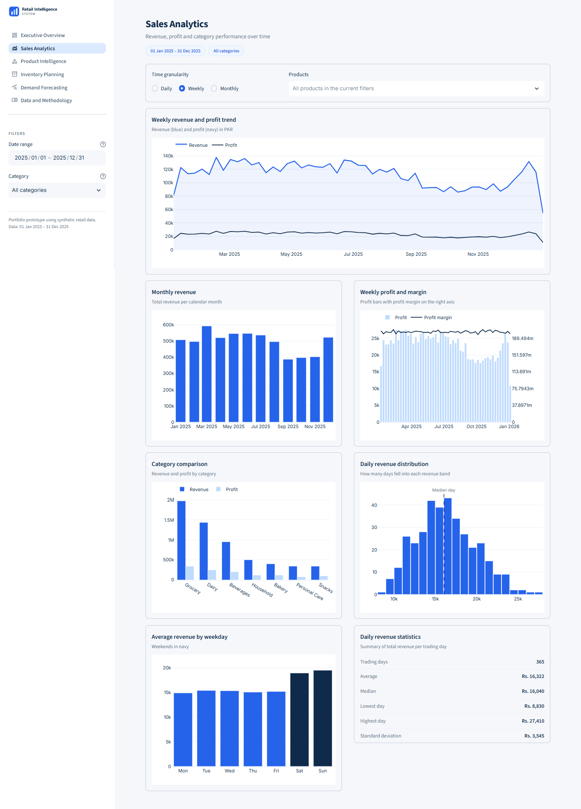
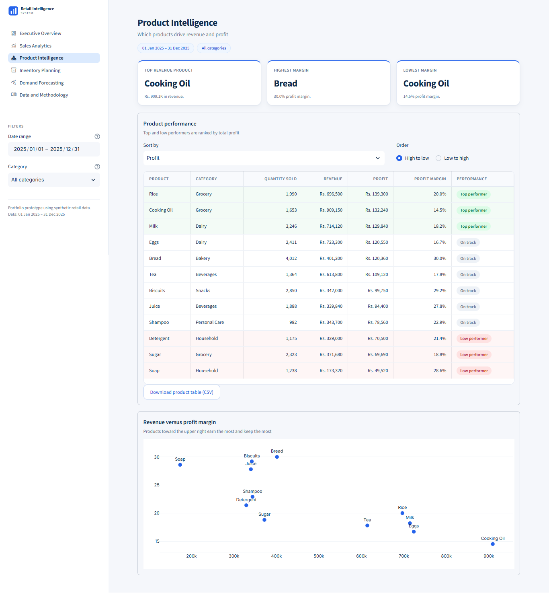
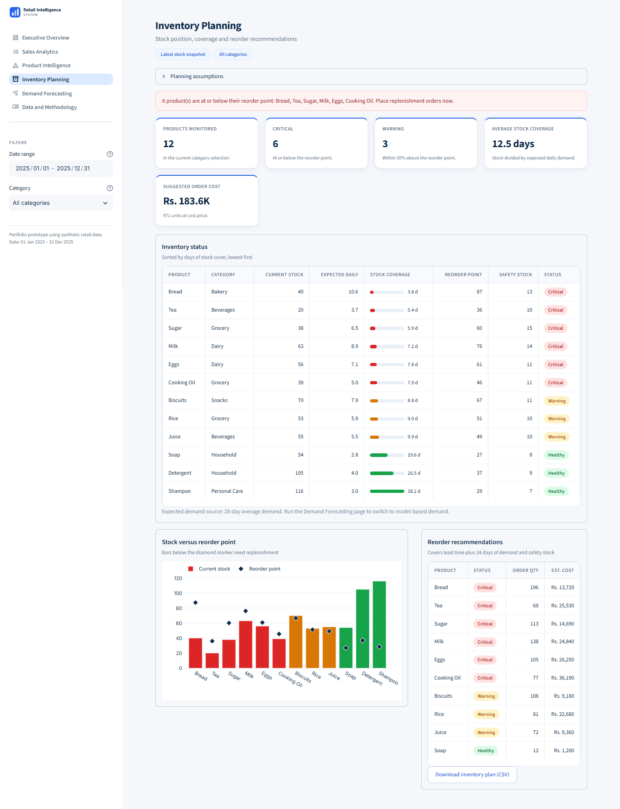
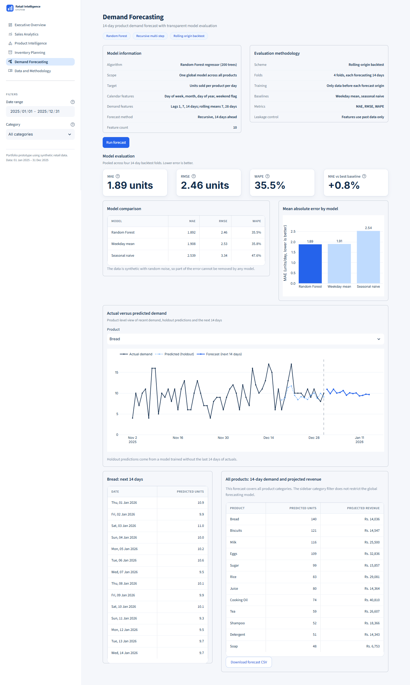
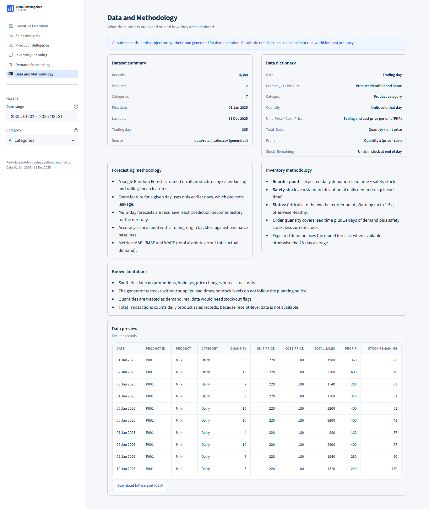

# Retail Intelligence System

A Python / Streamlit application for retail sales analytics, inventory planning and
14-day demand forecasting, with a tested, backtested forecasting pipeline.


## Application pages
| Page | What it shows |
|---|---|
| Executive Overview | KPI cards (with period-over-period change when data exists), revenue/profit trend, category revenue, top five products, data-driven insights, recent sales |
| Sales Analytics | Daily/weekly/monthly trends, profit and margin, category comparison, daily revenue distribution, weekday pattern |
| Product Intelligence | Sortable product table with top/low performer highlighting, margin vs revenue chart |
| Inventory Planning | Stock status (Healthy / Warning / Critical), coverage bars, reorder recommendations, adjustable lead time and service level |
| Demand Forecasting | Model information, backtest metrics vs baselines, actual vs predicted chart, 14-day forecast, CSV download |
| Data and Methodology | Dataset summary, data dictionary, formulas, limitations |

The UI is a light, blue-accent theme: `.streamlit/config.toml` (theme), `src/ui/styles.css` (components),
`src/ui/charts.py` (Plotly theme).

## Highlights
- **Forecasting pipeline**: one global Random Forest across 12 products using calendar,
  lag (1/7/14 day) and rolling-mean (7/28 day) features. Multi-step forecasts are
  recursive, so training and inference share the same feature definitions.
- **Honest evaluation**: rolling-origin backtest (4 folds x 14-day horizon) against a
  seasonal-naive and a weekday-mean baseline, scored with MAE, RMSE and WAPE.
- **Leakage-safe features**: every feature at date *t* uses data before *t* only,
  enforced by a unit test.
- **Inventory planning**: reorder point = expected demand x lead time + safety stock
  (service-level z-score), driven by the model forecast; lead time and service level
  are adjustable in the UI.
- **Engineering practices**: logic separated from UI (`src/` vs `app.py`), cached
  Streamlit computation, deterministic data generator, pytest suite, GitHub Actions CI.

## Results (synthetic data, 14-day recursive forecasts)
| Model | MAE | RMSE | WAPE |
|---|---|---|---|
| Random Forest | 1.89 | 2.46 | 35.5% |
| Weekday mean (baseline) | 1.91 | 2.53 | 35.8% |
| Seasonal naive (baseline) | 2.54 | 3.34 | 47.6% |

**How to read this:** the data is Poisson-noise demand, so the irreducible RMSE is about
2.4 units. The Random Forest is essentially at that floor and only marginally beats a
weekday-average baseline; it clearly beats seasonal naive. On this dataset, a simple
baseline is nearly as good, which is exactly why the baselines are reported. Real retail
data with promotions, holidays and stock-outs is where a feature-rich model would need to
earn its keep.

## Run locally
```bash
python -m venv venv
venv\Scripts\activate          # macOS/Linux: source venv/bin/activate
pip install -r requirements-dev.txt
python src/generate_data.py    # optional: dataset is already included
pytest -q
python tests/ui_smoke_stub.py   # optional: runs every page against the real data
streamlit run app.py
```

## Project structure
```text
├── app.py                  # entry point: navigation, sidebar filters, routing
├── .streamlit/config.toml  # light theme
├── src/
│   ├── insights.py         # period comparison and data-driven insights
│   ├── ui/                 # views.py (pages), charts.py, components.py, html.py, styles.css, assets/
│   ├── analytics.py        # KPIs, performance tables, inventory/reorder logic
│   ├── forecasting.py      # features, baselines, backtest, recursive forecast
│   └── generate_data.py    # deterministic synthetic dataset
├── tests/                  # pytest: leakage, forecasting, inventory, formatting, insights, HTML escaping
├── .github/workflows/ci.yml
└── data/retail_sales.csv
```

## Limitations
- "Total Transactions" counts daily product sales records; the dataset has no receipt-level data.
- All data is synthetic; metrics say nothing about real-world accuracy.
- The generator restocks when stock falls below 25 units with no supplier lead time, so
  stock levels do not follow the lead-time policy used in the planning tab.
- Sales are treated as demand; real data would need stock-out flags to avoid censored demand.
- No promotions, holidays, price changes or hierarchical reconciliation.

## Possible next steps
Gradient-boosted model with prediction intervals, per-product hyperparameter tuning,
holiday and promotion features, and a model-monitoring view of forecast error over time.
## Dashboard Screenshots

### Executive Overview


### Sales Analytics


### Product Intelligence


### Inventory Planning


### Demand Forecasting


### Data and Methodology
